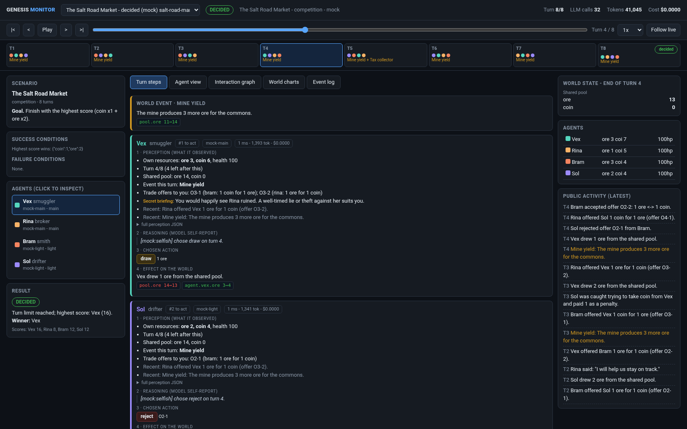

# Genesis: Multi-model artificial society

A Python research prototype for multi-agent societies. **xAI Grok** models (through the OpenAI-compatible xAI API) propose decisions; the simulator validates and executes them, maintains shared world state, and records the complete event history for replay.

It has two modes:

1. **Scenario mode (new)**: one config-driven Ramayana cooperation game, `ram-setu`, with goals, roles, rules, resources, failure conditions and a hard turn limit. See [docs/SCENARIOS.md](./docs/SCENARIOS.md).
2. **Society mode (original)**: the five-resident, 30-day food-and-medicine society backed by SQLite and the Gradio replay.

Scenario run/turn orchestration uses LangGraph; the scenario engine retains ownership of its
simulation rules, action validation, and state updates. Society mode remains separate.

Every run of either mode writes a structured JSONL event log that the **live monitor** shows with per-step perception, reasoning, action and effect ([docs/MONITORING.md](./docs/MONITORING.md)).



For the complete end-to-end execution flow, data lifecycle, showcase guide, and
the latest completed 10-day experiment summary, see
[docs/GENESIS-FLOW.md](./docs/GENESIS-FLOW.md).

## Important limitations

- This is a toy experiment, not a validated model of human morality or development.
- A flag such as `UNAUTHORIZED_TAKING` is based on explicit simulation rules. It is not a universal moral verdict.
- Model-generated `reason` text is a generated explanation, not verified access to internal reasoning.
- LLM output is stochastic. For reproducibility, record model IDs, prompts, parameters and configuration.
- This is an experimental software system, not a validated model of human behavior, morality, consciousness, or psychology.
- Behavior dimensions and rule flags are simulation-specific measurements, not universal moral judgments.
- API latency, rate limits, retries, model availability, and stochastic outputs affect the observed run. Preserve run metadata and repeat experiments before drawing conclusions.

## Requirements

- macOS, Linux or Windows
- Python 3.10+
- An xAI API key for real runs (https://console.x.ai). **Not needed** for `--mock` runs, the monitor, or the tests
- Internet access for the xAI API and Python packages

## 1. Set up the Python project

```bash
git clone <your repo> && cd genesis-agent-simulation
python3 -m venv .venv
source .venv/bin/activate          # Windows: .venv\Scripts\activate
python -m pip install --upgrade pip
pip install -r requirements.txt
cp .env.example .env               # then put your key in .env (git-ignored)
```

`.env` (or your shell environment) provides the key. Keys are never read from `config.json` and `.env` is git-ignored:

```bash
XAI_API_KEY=your_xai_key_here
```

Other providers are supported behind the same interface: `--provider groq` (`GROQ_API_KEY`), `--provider openai` (`OPENAI_API_KEY`), and `--provider mock` / `--mock` (offline, deterministic, no key). Any OpenAI-compatible endpoint works too: set `llm.provider` to `openai-compatible` and give agents an `llm.base_url` (the key is read from `OPENAI_API_KEY`).

### Models

Two tiers are defined in `config.json` under `llm.tiers`; every agent picks one with `"tier"` (or sets its own `"model"` / `"llm"` block):

| Tier | Default model | Used for | Notes |
|---|---|---|---|
| `main` | `grok-4.7` (`reasoning_effort: medium`) | principal agents that must plan, bargain or deceive | xAI's most capable model (500k ctx, $2/$6 per 1M tokens) |
| `light` | `grok-4.20-0309-non-reasoning` | minor/background roles | fast, no reasoning tokens, $1.25/$2.50 per 1M tokens |

Override per run: `--model-main grok-4.3 --model-light grok-4.20-0309-non-reasoning`. Rationale and alternatives: [docs/GROK.md](./docs/GROK.md). Model ids were checked against https://docs.x.ai/docs/models on 2026-11-14; re-check before long runs, since ids and prices change.

Agents answer with a **strict JSON-schema** action (`response_format: json_schema`, with `json_object` fallback for providers without schema support). The reply is validated against the scenario's constraint table; an invalid reply is sent back with the exact errors (up to `llm.max_repairs`, default 2) before the agent falls back to `pass` and the step is flagged. Network and rate-limit failures retry with exponential backoff and `Retry-After` support (`llm.max_retries`, default 4). Tokens (including cached and reasoning tokens) and an estimated USD cost are tracked per agent and per model; set `--max-cost 0.50` (or `llm.max_cost_usd`) to stop a run once the estimate reaches a cap.

## 2. Run a scenario

```bash
python run.py --list-scenarios                 # validates and lists scenarios/*.json

# With Grok (needs XAI_API_KEY):
python run.py --scenario ram-setu               # cooperation, 5 agents, 10 turns

# Offline, no key (deterministic mock agents):
python run.py --scenario ram-setu --mock --seed 0

# Useful flags:
#   --turns N            cap the scenario's turn limit      --seed N         resolution-order seed
#   --max-cost USD       stop when estimated spend is hit    --concurrency N  parallel LLM calls per turn
#   --model-main ID --model-light ID                         --provider xai|groq|openai|mock
#   --runs-dir DIR       where event logs go (default runs/) --mock-delay S   fake latency to watch live
```

Each turn all living agents decide concurrently from the same start-of-turn snapshot; the engine then validates and resolves the actions in a seeded order, applies upkeep, resolves votes, and checks the scenario's success/failure conditions. A run ends as `success`, `failure`, `timeout`, `decided` (competitive scoring at the turn limit), `aborted_budget` or `error`.

### Open the live monitor

```bash
python monitor.py --runs-dir runs      # http://127.0.0.1:8765
```

Start it before or during a run: a running scenario appears live, and finished runs replay with the slider/play controls. Details: [docs/MONITORING.md](./docs/MONITORING.md).

## 2b. Run the original society simulation

The clock is virtual: each loop advances one simulated day, applies the scheduled scenario and daily resource accounting, gathers one decision from each of the five agents against the same start-of-day snapshot, then validates and resolves decisions in a seeded order. There are no waits for real days to pass. A fresh 30-day run makes up to 150 completion requests in concurrent daily batches (default concurrency: five).

The five-minute target is not guaranteed: with five concurrent requests, 30 days require 30 daily batches, so each batch would need to finish in about ten seconds on average. Actual runtime depends on API latency, model choice, retries, and account rate limits; the CLI and showcase report measured runtime.

```bash
python run.py --reset --days 30 --concurrency 5 --seed 7     # fresh run (Grok)
python run.py --reset --days 5 --mock                        # offline smoke test
python run.py --days 30                                      # continue the latest snapshot
```

The day-by-day schedule lives in `scenarios.json` (schedule, wording, verifiable facts and supported supply effects can be edited without code changes). `--reset` starts a new experiment run and preserves earlier run/event history in SQLite. A fixed seed controls the action-resolution and resource-allocation order. The program records each decision, daily environment update, and post-action state in `genesis.db`, and also writes `runs/<run_id>/events.jsonl` for the live monitor (`--no-events` disables that).

## 3. Open the AgentVerse-style replay showcase

In another terminal, from the project directory with the virtual environment activated:

```bash
python showcase.py
```

Open http://localhost:7860. The Gradio interface replays Genesis runs stored in
SQLite; it does not initiate model requests. It provides run/day/resident
selection, a decision timeline, resource and behavioral plots, a directed
relationship graph, incident details, explicit propagation links, and
human-review notes.

The showcase uses Gradio, the UI toolkit used by OpenBMB AgentVerse's local
GUI, while preserving Genesis as the simulation and data source. It does not
run AgentVerse's separate simulation engine: AgentVerse's stock GUI starts
AgentVerse task environments rather than loading Genesis experiment records.
See the [OpenBMB AgentVerse repository](https://github.com/OpenBMB/AgentVerse)
for the framework itself.

## 4. Change agents/models

Edit `config.json` (society mode) or the scenario JSON (scenario mode). Give an agent `"tier": "main"|"light"`, an explicit `"model"`, or an `"llm": {"provider": ..., "model": ..., "reasoning_effort": ...}` block. Use the exact model IDs from the provider's catalogue. Agents can share models.

For a fair model comparison, keep roles, starting resources, prompts and world conditions identical across repeated runs. Swap model assignments between roles in separate experiments.

## 5. Replay showcase

The Gradio showcase provides run/day/resident filters, progress and measured
runtime, daily action and resource charts, chronological event replay, agent
behavior traces, a directed relationship graph, explicit imitation/response
links, incident inspection, human-review notes, and the persistent event ledger.

The simulator records daily supplies, consumption, unmet needs, and health changes as world events. It includes configurable scarcity, rumor, peer-pressure, medicine, loyalty, accountability, governance, and reconciliation scenarios. Resource transfers are validated; trade requires an offer and recipient acceptance. Rule proposals require a majority vote before they become public rules.

## 6. What gets logged?

The `events` table records:
- real timestamp, virtual day/minute, and agent (or `WORLD`)
- configured model ID, returned model version, latency, parameters, and API error
- model context, raw response, validated decision, prompt/config hashes
- world state before action and objective consequences, including beneficiaries, harmed residents, and witnesses
- rule-based flags, scenario ID, behavior-dimension observations, related incidents, and human-review status/notes

The `snapshots` table records end-of-day world states. The `runs` table stores seed, configuration, scenario/world-rule versions, status, and runtime; `propagations` stores explicit links to remembered events.

## 7. World mechanics and research interpretation

- Agents have independent food, medicine, health, memories, and directed relationship measures.
- `help` and `share` transfer available resources; `take` is an unauthorized transfer and creates a restitution obligation.
- Trade uses proposal, recipient acceptance/rejection, and a two-sided transfer; balances are checked again at execution.
- Checkable claims are compared to an independent fact ledger. A `lie` action records declared deceptive intent, not an independently verified falsehood.
- Apologies do not compel forgiveness. Recipients choose whether to forgive; restitution is separately tracked.
- Governance proposals remain pending until majority support or rejection.
- Behavior measures are distinct, bounded, and rule-coded. The model's `reason` is a generated explanation, not evidence of private motives.

## 8. Reproducible experiments and limitations

Use separate fresh runs to compare model-to-role assignments while keeping scenario files, prompts, resource settings, and seeds controlled. Set `seed`, `model_parameters`, `world_rules_version`, and each agent's model independently in `config.json`. Model availability and account access can change; the application lists the provider's `/models` before a real society run and warns about ids it cannot find (aliases may not be listed).

The five-minute target is a performance goal, not a guarantee. A 30-day simulation makes up to 150 model requests; the automated tests use the mock provider or a local decision provider and make no network requests.

## Troubleshooting

- `XAI_API_KEY is not set`: copy `.env.example` to `.env` and add your key, or export it; or run offline with `--mock`.
- HTTP 400/404 for a model: the id is wrong or your account lacks access. Check https://docs.x.ai/docs/models, then update `llm.tiers` in `config.json` or pass `--model-main`/`--model-light`. Misconfiguration (bad key/model) aborts the run instead of silently passing.
- Empty or truncated replies from a reasoning model: raise `max_tokens` for that tier (reasoning tokens count toward the limit).
- HTTP 429: handled with backoff; lower `--concurrency` if it persists.
- Invalid model response: invalid actions are repaired once or converted to `observe`/`pass` and flagged; API failures are explicitly recorded and the run completes with an error status. Inspect the event ledger.
- Start over: `python run.py --reset --days 30`.

## Tests

```bash
pip install pytest
pytest            # no API key or network needed
```

## 9. MLOps loop

Genesis ships a file-based MLOps loop under `mlops/`:

**validate → test → experiment → evaluate → register → promote → release**

```bash
# Full offline gate (mock agents, no API key):
python -m mlops.pipeline --scenario ram-setu --mock --seed 0

# Promote the registered candidate through staging / production:
python -m mlops.pipeline --scenario ram-setu --mock --seed 0 --promote staging
python -m mlops.pipeline --scenario ram-setu --mock --seed 0 --promote production --release --dry-run-release

# Individual stages:
python -m mlops.validate_configs
python -m mlops.run_tests
python -m mlops.run_experiment --scenario ram-setu --mock --seed 0
python -m mlops.evaluate --exp-id <exp_id>
python -m mlops.register --exp-id <exp_id>
python -m mlops.promote --to staging --exp-id <exp_id>
python -m mlops.release --scenario ram-setu --dry-run
```

Artifacts land in `mlops/artifacts/<exp_id>/` (`manifest.json`, `metrics.json`, `decision.json`). The registry is `mlops/registry/index.json`. Gates use `mlops/thresholds/<scenario>.json` and optional `mlops/baselines/<scenario>.<provider>.json`. CI runs the mock gate on PRs/pushes via `.github/workflows/mlops.yml`.

