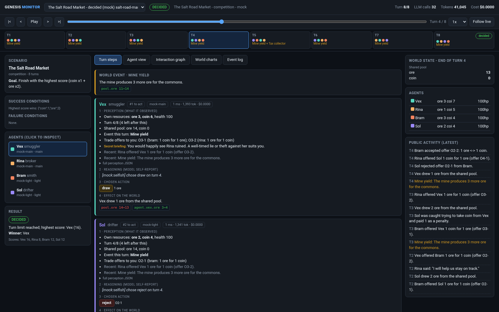
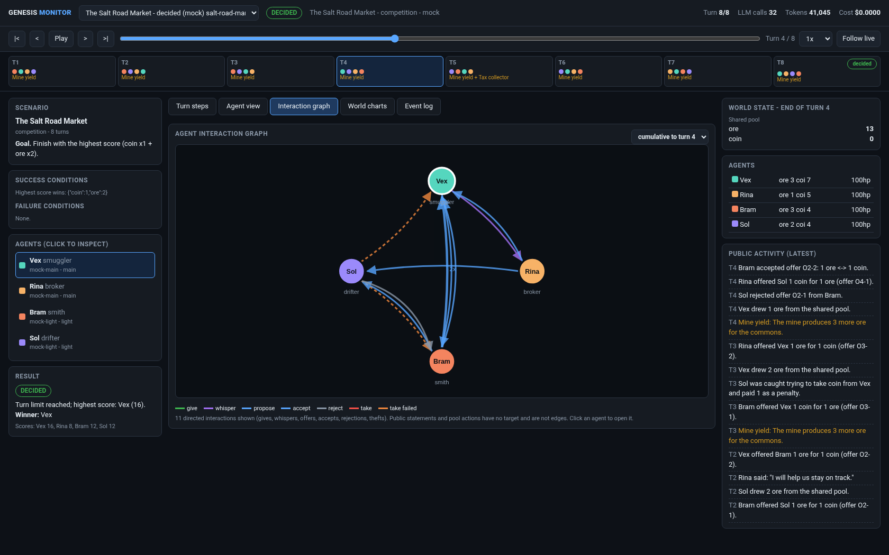

# Monitoring



```bash
python run.py --scenario diwali-bazaar --mock        # or without --mock for Grok
python monitor.py --runs-dir runs                    # http://127.0.0.1:8765
```

The monitor is a local, dependency-free web app (stdlib HTTP server + one HTML file with inline
JS/SVG, so it works offline). It reads `runs/<run_id>/events.jsonl` and polls for new events
every second, so a run in progress shows up live (the page auto-switches to a newly started
run unless you picked one yourself), and finished runs replay with the slider, play/pause,
speed control and arrow keys.

## What you see

* **Timeline** (top): one cell per turn with a coloured dot per agent action, the world events
  that fired, and the final outcome flag. Click a turn to jump to it.
* **Turn steps**: for the selected turn, one card per agent in resolution order with
  1. *Perception*: what the agent was shown (own resources/health, pool, events, offers, open
     votes, private messages, secret briefing, recent public log) with the full JSON expandable,
  2. *Reasoning*: the model's self-reported rationale (not hidden chain-of-thought),
  3. *Chosen action* with parameters and message, plus validation flags/errors,
  4. *Effect*: the engine's result text and exact state deltas (`pool.water 6->4`).
  Latency, tokens, cost, retries and repair counts are on each card.
* **Agent view**: persona/goals/model, resources and health over time, full action history.
* **Interaction graph**: directed edges between agents (gives, whispers, offers, accepts,
  rejections, thefts and exposed thefts), cumulative or per turn; click a node to inspect.
* **World charts**: pool, variables, per-agent resource/health, agents alive, cumulative cost.
* **Side panels**: scenario goal with live success/failure condition status, agents
  (dead ones struck out), world state at the selected turn, project progress bars, a public
  activity feed, and the final result.



## Event log format

JSONL, one object per line with `seq` (monotonic), `ts`, `run_id`, `type`:
`run_start`, `turn_start`, `world_event`, `agent_step`, `turn_end`, `run_end`. The
`agent_step` carries `perception`, `reasoning`, `action`, `validation` (flags, errors, raw reply),
`effect` (`summary`, `changes[{path,before,after}]`, `interactions[{from,to,type}]`) and
`llm` (provider, model, latency, usage, cost, retries, repairs, error). Both scenario mode and the
original society mode write this format, so the same dashboard shows either. See
`genesis/events.py`. The original SQLite store and Gradio showcase are untouched and still
available for society runs.

## Why not integrate MiroFish?

[MiroFish](https://github.com/666ghj/MiroFish) ("a simple and universal swarm intelligence
engine, predicting anything") was reviewed. It is a **prediction engine**, not a monitor: it
ingests seed documents, builds a GraphRAG knowledge graph (Zep Cloud), generates thousands of
personas and runs an OASIS-based social simulation, then writes a report. Integrating it would
mean replacing Genesis's simulator rather than observing it, and in practice:

* it needs a Node frontend plus a Python 3.11-3.12 backend, a Zep Cloud account/key and an
  LLM key (the Genesis monitor needs only Python);
* it is licensed **AGPL-3.0**, which would impose copyleft obligations on this project if its code
  were embedded or served;
* its simulation engine (OASIS) models social-media platforms, whereas Genesis scenarios are
  closed worlds with resources, rules and hard win/lose conditions that must be enforced by the
  engine, not generated.

So the decision is to **borrow its approach, not its code**:

* a *god's-eye view* of the whole world while agents only see their own perception (the monitor
  shows both side by side, including secrets only one agent had);
* *persona panels* and per-agent drill-down (agent view);
* an *interaction/relationship graph* to see who acts on whom;
* *replayable, inspectable* simulation state, here as an append-only event log;
* the idea of injecting variables from above, which scenarios already do through scheduled
  events and votes.

A separate dashboard process reading JSONL also keeps monitoring decoupled: you can tail logs
from a headless run on a server, archive them, or feed them to other tools. If you later want
MiroFish-style prediction reports, the JSONL log is a straightforward input for a separate
analysis step.

Why not FastAPI/Gradio? The existing Gradio showcase is heavy for a live, per-step view; FastAPI
would add dependencies for four trivial endpoints. A stdlib server keeps the monitor runnable
anywhere the simulation runs.
